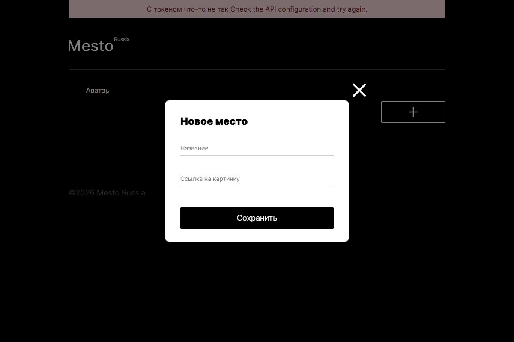

<div align="center">

# 🏞️ Mesto · React-клиент

**Версия фотоленты, в которой профиль, карточки и диалоги представлены React-компонентами.**

  

[Публичная страница](https://goldlexx.github.io/mesto-react/) · [Полная версия Mesto](https://goldlexx.github.io/react-mesto-api-full/)

</div>



## Интерфейс

Нажмите **«+»**, чтобы открыть форму нового места. Она принимает название и ссылку на фотографию. Отдельные диалоги отвечают за изменение профиля, аватара и просмотр крупного изображения. Данные текущего пользователя передаются через `CurrentUserContext`. По владельцу карточки компонент определяет, когда показывать кнопку удаления.

[App](src/components/App.js) хранит список карточек в состоянии React. После успешного ответа сервера новый элемент попадает в начало ленты, лайк обновляет выбранную карточку, а удаление убирает её из списка.

## Подключение к данным

В этой версии нет экранов регистрации и входа. [Клиент API](src/utils/api.js) читает профиль и карточки из совместимого сервиса. Значение по умолчанию указывает на историческую когорту Практикума. Во время подготовки документации опубликованный клиент показал ошибку доступа. Форму можно посмотреть, для сохранения нужен доступный API.

Для своего окружения задайте `REACT_APP_API_BASE_URL` в `.env.local`. Сервис должен поддерживать ожидаемый формат карточек, включая объекты владельца и пользователей в списке лайков, и маршруты вида `/cards/likes/:id`. Конфиденциальные ключи клиенту не передавайте.

## Установка и проверка

```sh
npm ci
npm start
```

Create React App запускает сервер разработки. `npm run build` создаёт статическую сборку. Модульные тесты клиента проверяют запрос обновления профиля и обработку ответа с ошибкой. Запуск — `npm test -- --watchAll=false`.
